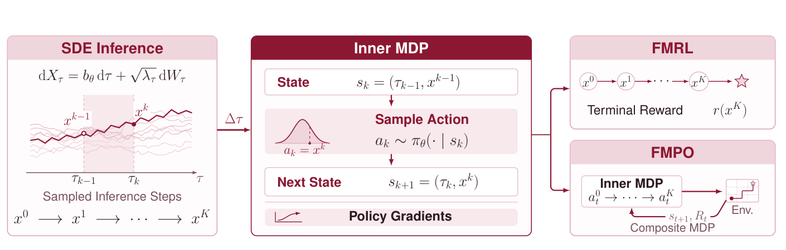

# Flow Matching Reinforcement Learning via SDE Inference

**Maojiang Su\*, Tsung-En Lin\*, Jerry Yao-Chieh Hu\*, Guo Ye, Haoran Lu, Shang Wu, Zhaoran Wang, and Han Liu**

\* Equal contribution

[Paper](docs/paper.pdf) | [Project page](https://magics-lab.github.io/flow_sde/) | [Reproduction guide](docs/REPRODUCIBILITY.md) | [Experiment map](docs/EXPERIMENTS.md) | [Citation](CITATION.cff)

Research code for the manuscript updated **November 18, 2026**. The framework treats stochastic flow inference as an inner MDP, connects it to policy optimization in an environment, and studies when improvements under training-time SDE inference transfer to deployment-time ODE inference. FMPO-CPPO combines a chain-level PPO surrogate with an auxiliary step-wise surrogate.



*Framework schematic from Figure 1 of the paper.*

## Experiments

| Paper result | Code | Included artifacts |
| --- | --- | --- |
| Figure 2(a), Section 5.1 | [NumericalExp](NumericalExp/): TV versus flow-matching error | Experiment code; original measurements unavailable |
| Figure 2(b,c), Section 5.2 | [NumericalExp](NumericalExp/): transfer violations and reward trajectories | Experiment code; original measurements unavailable |
| Figure 3, Section 5.3 | [FMPO_Evaluation](FMPO_Evaluation/): four MuJoCo tasks, three methods | 60 CSVs, five seeds per task and method |
| Figure 4, Section 5.4 | [CIFAR32Exp](CIFAR32Exp/): weak, medium, strong CIFAR-10 models | Nine histories, three seeds per base model |
| Figure 5, Appendix G | FMPO-CPPO auxiliary-loss ablation | Training and plotting entry points; NoAux logs unavailable |
| Table 2, Appendix F.3 | Training time per iteration | Exporter for new runs; original timing records unavailable |

Figure 1 is the framework schematic in the paper. The exact snapshot, available artifacts, and remaining reproduction limits are documented in the [reproduction guide](docs/REPRODUCIBILITY.md).

## Quick start: reproduce recorded curves

From the repository root, using Python 3.10 or newer:

```bash
python -m pip install -r requirements-plots.txt
python scripts/reproduce_figures.py
```

This reads the supplied logs and writes the four MuJoCo panels, four CIFAR panels, and the conditional-improvement analysis under `figures/`. It requires no GPU, datasets, or checkpoints. Recorded curves can be regenerated independently of training.

## Train models

Each experiment suite has its own environment and instructions:

- [Synthetic experiments](NumericalExp/README.md): Gaussian bridges, TV estimation, and SDE-to-ODE transfer.
- [Continuous control](FMPO_Evaluation/README.md): ReinFlow, Flow-SDE, FMPO-CPPO, and NoAux on Hopper-v2, Walker2d-v2, Ant-v2, and Humanoid-v3.
- [CIFAR-10](CIFAR32Exp/README.md): classifier preparation, flow pretraining, and SDE GRPO fine-tuning.

Keep MuJoCo training in a separate Linux environment: it uses legacy Gym and D4RL. Downloaded data, checkpoints, and new training runs are excluded from Git; the supplied CSVs and histories are included.

## Tests and artifact inventory

The CPU tests use small models and synthetic data, with no environment rollouts or downloads.

```bash
python -m pip install -r requirements-dev.txt
python scripts/run_tests.py
python scripts/make_manifest.py
```

`MANIFEST.json` records SHA-256 hashes and explicitly lists missing artifact groups. Add `--checkpoints <paths or globs>` to inventory local checkpoints. CI runs each suite in a separate process and checks the supplied result records.

## Citation

```bibtex
@misc{su2026flowmatchingrl,
  title  = {Flow Matching Reinforcement Learning via SDE Inference},
  author = {Su, Maojiang and Lin, Tsung-En and Hu, Jerry Yao-Chieh and Ye, Guo and Lu, Haoran and Wu, Shang and Wang, Zhaoran and Liu, Han},
  year   = {2026},
  note   = {Manuscript updated November 18, 2026}
}
```

## Acknowledgements and licenses

The continuous-control implementation derives from ReinFlow and DPPO. Their copyright headers and the [ReinFlow license](FMPO_Evaluation/FMPO-CPPO/LICENSE) are retained. See [LICENSES.md](LICENSES.md) for the original root license and the MIT notice supplied with the consolidated paper release.
